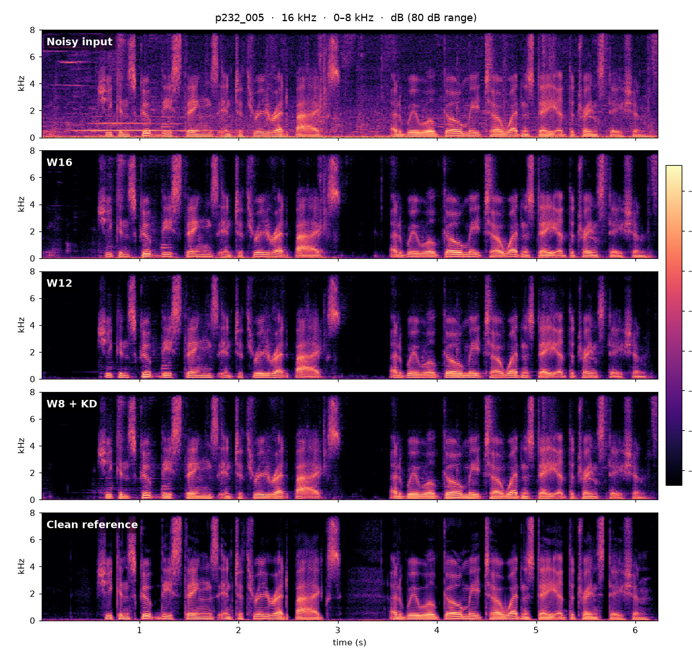
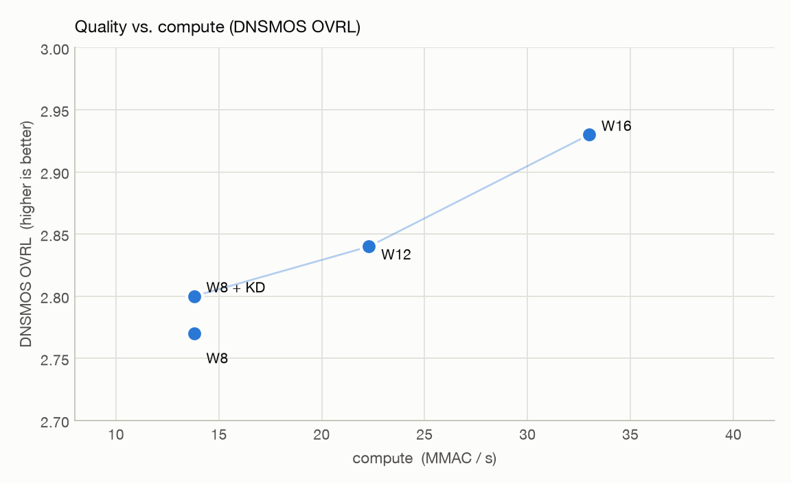

# Neural Speech Denoiser — Results

Real-time, single-channel **AI noise suppression** for edge devices. A compact
neural network (8 K – 24 K trainable parameters) estimates a spectral mask frame
by frame and is implemented in **framework-free C** for embedded targets with a
single-precision FPU: one 16 ms frame in, one out, no heap allocation, no
library-static RAM, and a total footprint of **113 – 218 KB** of Flash + RAM
depending on the model width.

**This repository publishes results, not code.** It contains objective scores,
footprint and compute measurements, spectrograms and before/after audio produced
by the compiled library. The implementation, model weights, training pipeline
and tooling are proprietary and not included.

## What it does

```
16 kHz PCM, 256-sample frame ──► STFT (32 ms window, 50 % overlap)
     ──► compact encoder–decoder network with a recurrent bottleneck
     ──► complex spectral mask ──► inverse STFT + overlap-add
     ──► 16 kHz PCM, one frame later
```

- **Streaming**: fixed 16 ms frames, causal in time; algorithmic latency is one
  frame plus the STFT window (≈ 32 – 48 ms) and does not depend on CPU speed.
- **Zero heap, zero static RAM**: every buffer (recurrent state, scratch, FFT
  tables) lives in a single caller-provided instance block; the library's own
  `.bss` and `.data` are 0 bytes. The block can be placed in fast on-chip memory by the linker.
- **Plain C11, single-precision FPU only**, no dependencies (own radix-4 real
  FFT); int16 PCM in/out with in-place buffers allowed, float variant available.
- **Three model widths** (W16 / W12 / W8) behind one API and one audio
  contract; the width is a compile-time constant.
- **Run-time suppression knob**: the mask exponent can be tuned per product at
  init, no rebuild.

## Listen

**▶ [Listening page](https://r7788380.github.io/speech-denoiser-sdk-results/)**
([中文版](https://r7788380.github.io/speech-denoiser-sdk-results/zh.html)) —
every clip below with an in-browser player, per-clip scores and spectrograms.

Five utterances from the public **VCTK-DEMAND** noisy test set (speakers p232 and
p257, English, 16 kHz). Each is provided as the noisy input, the output of the
compiled C library at all three widths, and the clean studio recording
(`listening/<utterance>_{noisy,w16,w12,w8kd,clean}.wav`):

| Utterance | Length | Files |
|---|---|---|
| p232_005 | 6.2 s | [`listening/`](listening/) |
| p232_070 | 2.5 s | [`listening/`](listening/) |
| p232_358 | 1.7 s | [`listening/`](listening/) |
| p257_240 | 2.9 s | [`listening/`](listening/) |
| p257_430 | 3.4 s | [`listening/`](listening/) |

The enhanced files are the int16 streaming output of the host build of the
library (suppression strength 1.0), not of the Python model. They trail the
input by one 16 ms frame, as the library does.



## Model variants

Our full-size model next to published lightweight real-time denoisers. The
DNS OVRL scores are taken from each model's own publication and were not
measured on a common test set, so they indicate magnitude only.

| Year | Model | Params | MMAC / s | DNS OVRL ↑ |
|---|---|---|---|---|
| 2018 | RNNoise | ~60 K | ~40 | 2.53 |
| 2024 | FSPEN | 79 K | 89 | not published |
| 2025 | UL-UNAS | 171 K | 35 | 2.71 |
| 2026 | **Ours (W16)** | ≈ 24 K | 33 | **2.93** |

Our model widths, trained on DNS-Challenge speech and noise with on-the-fly
mixing (SNR uniformly −5 … 15 dB, 4 s crops, 16 kHz) and scored with **DNSMOS**
— the non-intrusive P.808 MOS and the P.835 speech (SIG), background (BAK) and
overall (OVRL) scores — on a held-out noisy test set.

| Variant | Trainable params | MMAC / s | P.808 ↑ | SIG ↑ | BAK ↑ | OVRL ↑ |
|---|---|---|---|---|---|---|
| W16 | ≈ 24 K | 33 | 3.63 | 3.22 | 3.95 | 2.93 |
| W12 | ≈ 15 K | 22 | 3.50 | 3.15 | 3.88 | 2.84 |
| W8 | ≈ 7.9 K | 14 | 3.44 | 3.10 | 3.80 | 2.77 |
| **W8 + KD** | ≈ 7.9 K | 14 | 3.48 | 3.13 | 3.81 | 2.80 |

- **W12 / W8** shrink the channel width of the W16 network; at 42 % of the
  compute, W8 gives up 0.16 OVRL.
- **W8 + KD** is W8 fine-tuned by knowledge distillation from the W16 teacher
  (ground-truth loss + mask MSE against the teacher + spectral loss against the
  teacher's output). It adds +0.03 OVRL and +0.04 P.808 at identical cost and
  is the variant deployed at the smallest footprint.



## Footprint

Measured on the embedded build (GCC 15, `-O3 -ffast-math`, single-precision
hard-float). Compute is the instruction count measured in an instruction-set
emulator at 62.5 frames per second; it is a proxy for cycles, not a silicon
measurement — expect roughly 1.1 – 1.5 × on a real core, depending on memory
placement.

| | W16 | W12 | W8 + KD |
|---|---|---|---|
| Compute (M instructions / s) | 133.3 | 89.8 | 54.8 |
| Instructions per 16 ms frame | 2.13 M | 1.44 M | 0.88 M |
| Flash: code + weights | 121.7 KB | 86.4 KB | 58.3 KB |
| Library static RAM (`.bss` + `.data`) | 0 | 0 | 0 |
| Instance RAM (caller-provided) | 95.9 KB | 74.2 KB | 54.3 KB |
| **Total** | **217.6 KB** | **160.6 KB** | **112.6 KB** |

W8 + KD fits a **100 MHz** embedded core (55 % of the cycle budget by
instruction count, roughly 60 – 80 % after the real-core factor); W12 needs
roughly 150 – 180 MHz and W16 about 250 MHz.

## Runtime on a desktop host

For reference only — the target is an embedded core. Host build of the same C source,
Apple M1, clang 15 `-O3 -ffast-math`, single core, 60 s of audio:

| | W16 | W12 | W8 + KD |
|---|---|---|---|
| Time per 16 ms frame | 128 µs | 90 µs | 56 µs |
| Real-time factor | 0.008 | 0.006 | 0.0035 |

## License

Sample audio, figures and evaluation results are provided for **evaluation
only**; see [`LICENSE`](LICENSE).

Speech excerpts: *Noisy speech database for training speech enhancement
algorithms and TTS models* (VCTK-DEMAND), C. Valentini-Botinhao, University of
Edinburgh, CC BY 4.0. DNSMOS: Microsoft DNS Challenge (MIT).
